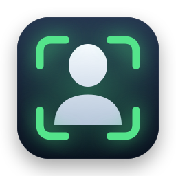

# FaceRec for Mac (Swift)

Native rewrite of the Python app in `../FaceRec`. Same behaviour, no Python at run time.

| Stage | How it runs |
|---|---|
| Camera | AVFoundation, mirrored, at the resolution and frame rate you pick |
| Video display | Metal (`MetalVideoView.swift`), each frame drawn as it arrives, camera buffers wrapped as textures without copying |
| Face detection + landmarks | Vision |
| Face embedding | FaceNet (InceptionResnetV1, VGGFace2) on Core ML |
| Object detection | YOLOv8n on Core ML |
| Tracking, recognition, database | Plain Swift ports of `tracker.py`, `recognizer.py`, `database.py` |

Core ML decides where each layer runs. On an M5, `--selftest` reports 99% of FaceNet's and 98% of YOLOv8n's layers on the Neural Engine.

## Build and run

The models are not in the repository. Convert them once (needs `uv`, about 150 MB of downloads):

```bash
Tools/setup_models.sh
```

Then build:

```bash
Tools/build.sh
```

```bash
open build/Build/Products/Release/FaceRec.app
```

`Tools/build.sh` signs with an Apple Development certificate if the keychain has one, so macOS remembers the camera permission between builds. You can also open `FaceRec.xcodeproj` in Xcode and press Run.

## Controls

| Key | Toolbar | Action |
|---|---|---|
| `A` | Name Face | Name the largest face in frame (shows its picture; pick an existing person to add to them) |
| | Camera and quality menus | Choose the camera, its resolution and its frame rate (remembered per camera) |
| `O` | Objects | Toggle object detection |
| `L` | People | Show known people with their picture and learned angles; hover a row for rename and delete |
| `S` | More › Save Database | Save the database now |
| | More › Enrol from Photos | Add a person from image files |
| | More › Identify a Photo | Recognise the faces in an image file |

On the video, a white bracket is an unknown face and a green one a recognised face (shading to orange for weaker matches). A spark next to a name means that frame was just learned. The capsules at the top-left show camera frame rate, frames analysed per second, faces in view, samples learned since launch and, when on, objects in view. A green ring around a picture in the People panel means that person is in view.

The database is saved every 30 seconds and on quit, to
`~/Library/Application Support/FaceRec/faces.json` (the Python app's JSON layout plus head angles; Python-format files still load). One small face picture per person is kept beside it in `avatars/`.

## Continuous learning

After a person is named once, the app keeps learning them:

- **Angles are filed separately.** Samples are sorted into 9 head-angle bins (left/centre/right turn by up/level/down tilt), 16 per bin. A new angle is never crowded out by more frontal frames. The grid next to each name in the People panel shows which angles are covered.
- **Confident matches refresh the samples.** A match of 72% or more that clearly beats every other person is stored if it shows something new, or replaces a stored near-duplicate if it is sharper or the stored one is over a week old.
- **New angles are learned through tracking.** When a tracked, confirmed face turns far enough that it is no longer recognised, the frame is stored if it is still close to something already known about that person and does not look like anyone else. Coverage grows step by step as the head turns.
- **Naming enrols every angle seen so far.** While a face is unnamed, the tracker collects its varied views; pressing `A` stores all of them.
- **Safeguards.** A track must agree on a name 5 times before it can teach new angles, and a track drops its name after 6 frames that look nothing like that person.

## Accuracy and speed

Measured with `FaceRec --benchmark` on the LFW face-pairs benchmark, through the app's own detector, alignment and embedding (M5):

| | Held-out test pairs (1000) |
|---|---|
| Best verification accuracy | 99.2% |
| Same-person pairs accepted at the app's 0.55 threshold | 97.0% |
| Different-person pairs accepted at 0.55 | 0 of 500 (0.09% on the 2200 tuning pairs) |
| Time per image, one face | 6.5 ms |

What the app does for accuracy: each face is embedded twice (as seen and mirrored) and the two are averaged; identity is decided on a blend of a track's recent frames, so one blurred frame cannot flip a name; and a different name has to win twice in a row before a track switches to it.

A 1280×720 frame with two faces takes about 10 ms to analyse (detect 5, landmarks 2, align 1, embed 4), so analysis keeps up with a 60 fps camera.

To rerun the benchmark, give it a file with one pair per line: `imageA<TAB>imageB<TAB>1` for the same person or `0` for different people.

```bash
build/Build/Products/Release/FaceRec.app/Contents/MacOS/FaceRec --benchmark pairs.tsv
```

## Models

`FaceRec/Models/*.mlpackage` are converted from the original PyTorch weights by `Tools/setup_models.sh` and are not committed. The app icon is drawn by `Tools/make_icon.swift`.

## Self-test

Checks the models and the still-image pipeline without a camera or window:

```bash
build/Build/Products/Release/FaceRec.app/Contents/MacOS/FaceRec --selftest photo1.jpg photo2.jpg
```

To review the interface without a camera, this draws it over a photo into `video.png` and `people.png`:

```bash
build/Build/Products/Release/FaceRec.app/Contents/MacOS/FaceRec --render /tmp photo.jpg
```

## Differences from the Python app

- Faces are found with Vision instead of MTCNN, then rotated upright from the eye and mouth positions before embedding. Embeddings from a Python `faces.json` are close but not identical, so re-enrol people for best accuracy.
- Unknown faces always get a white "Unknown" bracket. The Python app hid them until someone was enrolled.
- A name typed with `A` is always stored. The Python app silently dropped it when the frame was blurry.
- Quit with ⌘Q; bare `Q` and `Esc` do not quit.
- YOLOv8 is AGPL-licensed, which matters if the app is ever distributed.
